<p align="center">
  
</p>

<p align="center">
  <a href="https://www.anypayx.com"></a>
  <a href="https://www.npmjs.com/package/seed-phrase"></a>
  <a href="https://www.npmjs.com/package/seed-phrase"></a>
  
</p>

<p align="center">
  <a href="https://www.anypayx.com">Website</a> ·
  <a href="https://www.anypayx.com/docs">Docs</a> ·
  <a href="https://api.anypayx.com/api">API</a> ·
  <a href="https://www.anypayx.com/walletbot">WalletBot</a> ·
  <a href="https://github.com/anypay">GitHub</a> ·
  <a href="https://www.npmjs.com/package/seed-phrase">npm</a>
</p>

---

## What It Is & Purpose

**Seed Phrase** is a lightweight command-line utility that generates cryptographically secure BIP39 mnemonic seed phrases. Built on the battle-tested [`bip39`](https://github.com/bitcoinjs/bip39) library, it provides a simple, auditable tool for creating the 12–24 word recovery phrases that form the foundation of hierarchical deterministic (HD) wallet key derivation.

This CLI was created as part of Anypay's internal tooling to support secure wallet initialization, testing environments, and developer workflows that require deterministic key generation across Bitcoin, Ethereum, and other blockchain networks.

Seed phrases generated with this tool follow the [BIP39 specification](https://github.com/bitcoin/bips/blob/master/bip-0039.mediawiki) and are compatible with any wallet software that implements the standard—including MetaMask, Ledger, Trezor, Electrum, and Anypay's own WalletBot.

## Why Use It

**Seed Phrase** delivers a focused, zero-configuration solution for mnemonic generation without requiring a full wallet framework or blockchain client.

- **Who it's for:** Developers building HD wallets, security researchers testing key derivation, and operators provisioning self-custody infrastructure.
- **Where it fits:** This tool sits at the entry point of Anypay's key management stack. The generated mnemonics feed into WalletBot for automated payment signing, and into test harnesses that verify multi-chain address derivation paths used by Anypay invoices.

**Key advantages:**

- **Single-purpose CLI** — does one thing (generate BIP39 mnemonics) and does it well, with no wallet state or on-disk storage.
- **Cryptographically secure** — relies on Node.js's native `crypto.randomBytes` via the `bip39` library for entropy generation.
- **Universally compatible** — produces standard 12-word mnemonics that work across every BIP39-compliant wallet in the ecosystem.
- **Zero dependencies** (beyond `bip39` itself) — minimal attack surface, easy to audit, and fast to install.

## How It Works

<p align="center">
  
</p>

The `seed-phrase` CLI implements a straightforward BIP39 workflow:

1. **Entropy generation** — The tool calls `bip39.generateMnemonic()`, which samples 128 bits of cryptographically secure random data from the operating system's entropy pool via Node.js `crypto.randomBytes`.

2. **BIP39 encoding** — The 128-bit entropy is mapped to a 12-word mnemonic using the BIP39 English wordlist (2048 words). The final word includes a checksum derived from the entropy, ensuring integrity.

3. **HD seed derivation** — While this CLI only outputs the mnemonic, that phrase can be passed to any BIP32/BIP44-compatible library to derive a master seed and generate hierarchical deterministic keys for multiple blockchain networks.

4. **Multi-chain address generation** — The derived keys follow standard derivation paths (`m/44'/0'/0'/0` for Bitcoin, `m/44'/60'/0'/0` for Ethereum, etc.), enabling a single mnemonic to manage addresses across Bitcoin, Ethereum, Litecoin, Dogecoin, and other chains supported by Anypay.

**Security note:** This tool prints the mnemonic to stdout. In production environments, pipe output directly into secure storage or a password manager. Never commit seed phrases to version control or logs.

## Quickstart / How to Use It

### Installation

Install globally via npm:

```bash
npm install -g seed-phrase
```

### Generate a Seed Phrase

Run the CLI to generate a 12-word BIP39 mnemonic:

```bash
seed-phrase
```

**Example output:**

```
alarm dinosaur shine match indicate now animal kidney busy vast enough mistake
```

Each invocation generates a new, cryptographically random mnemonic. The output is printed to stdout with no additional formatting, making it safe to pipe into other tools:

```bash
# Save to a file (use with caution—secure storage recommended)
seed-phrase > my-seed-phrase.txt

# Copy to clipboard (macOS)
seed-phrase | pbcopy

# Copy to clipboard (Linux with xclip)
seed-phrase | xclip -selection clipboard
```

### Verifying the Mnemonic

To verify that the generated phrase is valid BIP39, you can use the same `bip39` library in a Node.js REPL:

```bash
node -e "const bip39 = require('bip39'); console.log(bip39.validateMnemonic('alarm dinosaur shine match indicate now animal kidney busy vast enough mistake'))"
# Output: true
```

### Integration with WalletBot

Seed phrases generated by this tool can be imported into Anypay's [WalletBot](https://github.com/anypay/walletbot) for automated payment signing:

```bash
# Example WalletBot initialization (pseudo-code)
export WALLETBOT_MNEMONIC=$(seed-phrase)
walletbot start
```

## Next Moves for Growth

This repository is feature-complete for its single-purpose mission, but there are several high-leverage improvements that would expand its utility across Anypay's developer ecosystem:

1. **Add 24-word mnemonic support** — Accept a `--words 24` flag to generate 256-bit entropy mnemonics for users requiring higher security margins. The `bip39` library already supports this via `generateMnemonic(256)`.

2. **Publish to npm** — The package exists in `package.json` but is not currently published to the npm registry. Running `npm publish` would make global installation discoverable and align the package name with the actual binary command.

3. **CLI options for custom entropy** — Add an `--entropy` flag to accept hex-encoded entropy from external sources (hardware RNGs, dice rolls, etc.) and convert it to a valid BIP39 mnemonic. This would support airgapped or offline key generation workflows.

4. **TypeScript migration** — Convert `index.js` to TypeScript and add strict type definitions. This aligns with the broader Anypay SDK (`@anypay/client`) and improves developer experience when importing the module as a library.

5. **Add validation and conversion modes** — Extend the CLI to accept subcommands: `seed-phrase generate` (default), `seed-phrase validate <mnemonic>`, and `seed-phrase to-seed <mnemonic>` (output the BIP39 seed hex). This would make the tool useful for both generation and verification workflows.

6. **Security audit and reproducible builds** — Document the entropy source chain (Node.js → OpenSSL → OS), add a `SECURITY.md` file, and configure deterministic npm packaging so security-conscious users can verify the published tarball matches the GitHub source.

7. **GitHub Actions CI** — Add a minimal CI pipeline that runs `npm install && npm test` (once tests exist) on every push and PR. This would catch regressions if additional functionality is added.

## Anypay Ecosystem & License

**Seed Phrase** is part of [Anypay](https://www.anypayx.com) — Bitcoin & Stablecoin payments for business. Merchants and developers use Anypay to accept BTC, ETH, and stablecoins such as USDC, USDT, RLUSD, and NUSD through invoices, APIs, SDKs, webhooks, WooCommerce, and mobile POS.

| Project | Role |
| --- | --- |
| [anypay](https://github.com/anypay/anypay) | Invoice & payments platform / API (`@anypay/server`) |
| [anypay-sdk](https://github.com/anypay/anypay-sdk) | TypeScript SDK for browser & Node.js (`@anypay/client`) |
| [walletbot](https://github.com/anypay/walletbot) | Self-custody headless wallet that uses BIP39 mnemonics for automated signing (`@anypay/walletbot`) |
| [web3-checkout-vite](https://github.com/anypay/web3-checkout-vite) | Current checkout UI (`checkout.anypayx.com`) |
| [anypayx.com](https://github.com/anypay/anypayx.com) | Marketing site, merchant dashboard, and developer docs |
| [merchant-app](https://github.com/anypay/merchant-app) | iOS & Android point-of-sale |
| [anypay-woocommerce](https://github.com/anypay/anypay-woocommerce) | Official WooCommerce plugin |

### Related Key Management Tools

- **[bitcoinjs/bip39](https://github.com/bitcoinjs/bip39)** — The underlying BIP39 implementation library.
- **[walletbot](https://github.com/anypay/walletbot)** — Accepts seed phrases and derives keys for Bitcoin, Ethereum, Litecoin, Dogecoin, Dash, and more.

### License

This project is licensed under the **ISC License**. See the `package.json` `license` field for details.

The ISC license is functionally equivalent to the MIT and BSD 2-Clause licenses, with simplified language. It is a permissive free software license that allows reuse with minimal restrictions.

---

<p align="center">
  <a href="https://www.anypayx.com"></a><br/>
  <sub>Bitcoin & Stablecoin Payments For Business · <a href="https://www.anypayx.com">anypayx.com</a> · <a href="https://x.com/xanypay">@xanypay</a></sub>
</p>
